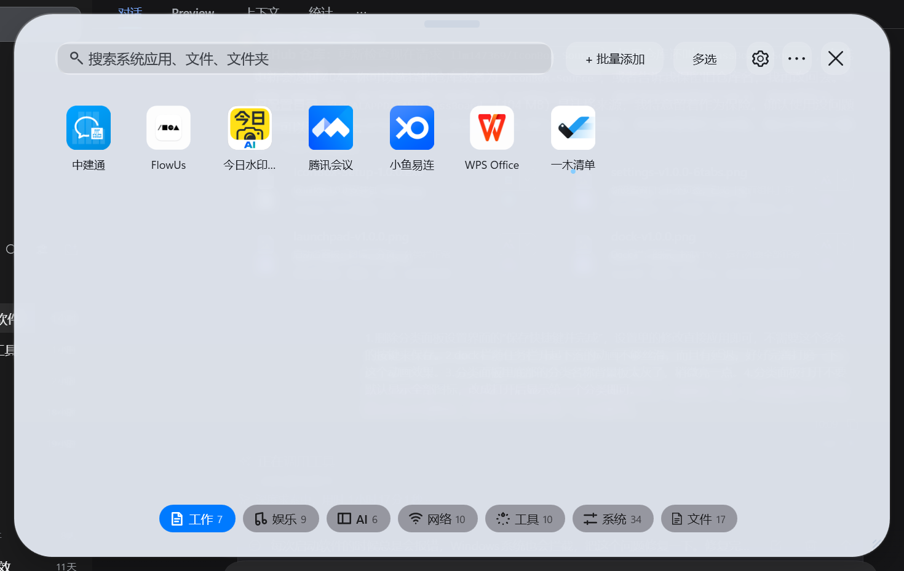

# IconBox

> Windows 桌面启动台：底部 Dock 栏 + 分类面板 + 控制中心。玻璃拟态（Glassmorphism）风格，把散落的桌面快捷方式收进一个漂亮的盒子里。

IconBox 是一个面向 Windows 10 / 11 的桌面整理与增强工具：把桌面上的快捷方式收纳进「启动台」面板与底部 Dock，桌面随之保持干净；同时提供任务栏自动隐藏、透明控制中心、Dock 跟随任务栏、图标批量整理等能力。项目使用 C# / WPF（.NET Framework 4.8）实现，单进程、无外部运行时依赖。



---

## 目录

- [主要能力](#主要能力)
- [界面构成](#界面构成)
- [Dock 与任务栏的行为规则](#dock-与任务栏的行为规则)
- [桌面整理规则](#桌面整理规则)
- [分类面板的操作](#分类面板的操作)
- [外观与材质](#外观与材质)
- [快捷键](#快捷键)
- [设置项一览](#设置项一览)
- [数据与日志位置](#数据与日志位置)
- [构建与发布](#构建与发布)
- [目录结构](#目录结构)
- [版本历史](#版本历史)
- [已知限制](#已知限制)
- [许可](#许可)

---

## 主要能力

- **启动台面板**：`Ctrl + Alt + Space` 呼出，按分类浏览全部应用，支持搜索、分页、拖拽排序、拖入文件批量添加、**文件复制粘贴**。
- **Dock 栏**：贴在任务栏上方，图标尺寸、栏高、圆角、间距、透明度、弹簧放大均可调；可常驻、可悬停自动隐藏、可跟随任务栏。
- **Dock 跟随任务栏**：任务栏弹出时 Dock 同帧上浮、收起时同步沉底；鼠标已经在 Dock 上时不会被任务栏带走（不会出现「还没点到就掉下去」）。
- **显示桌面图标**：面板已收录的桌面条目自动隐藏（默认只隐藏快捷方式，文档/文件夹保持可见），从面板移除后自动恢复。
- **shell 桌面图标收纳**：`此电脑` / `回收站` 通过注册表 `HideDesktopIcons` 隐藏，可随「恢复桌面所有图标」一起还原。
- **批量添加与去重**：扫描桌面 / 开始菜单 / 文件夹时按「路径 + 快捷方式目标 + 文件主名」三重判重，不会再把已添加的应用列一遍；同一应用的多份快捷方式只保留一份入口。
- **面板软件补到桌面**：一键把面板里收录的软件重新生成为桌面快捷方式（只补真实可执行程序，不改文档）。
- **控制中心**：音量 / 亮度 / 媒体 / Wi-Fi·蓝牙 / 电源 / 锁屏 / 此电脑 / 回收站 等快捷控制，外观默认跟随 Dock DIY 的设置。
- **桌面增强**：隐藏/显示任务栏、隐藏/显示桌面图标、Windows 任务栏自动隐藏总开关，全部可用快捷键触发。
- **外观自定义**：浅色/深色玻璃、统一透明度与模糊、边缘高光、强调色、玻璃材质 DIY、图标包；设置内实时预览，改完即时生效，没有「保存」按钮。
- **备份与恢复**：布局、快捷键、外观方案、自定义图标可导出为备份包，也可从旧版备份恢复。
- **在线更新**：从 GitHub Releases 检查新版本并替换程序文件。

## 界面构成

| 界面 | 说明 |
|---|---|
| **启动台面板** | 全屏玻璃面板，顶部工具栏（搜索 / 批量添加 / 多选 / 设置 / 更多 / 关闭），中间为应用磁贴，底部为分类栏 |
| **Dock 栏** | 底部一条玻璃栏：应用面板、常用应用、控制中心、正在运行的程序；支持拖入文件固定、拖出取消固定 |
| **控制中心** | 从 Dock 打开的小面板：音量 / 亮度 / 播放控制 / Wi-Fi·蓝牙、六个「系统快捷」（此电脑、回收站、网络、设置、电源、锁屏） |
| **运行列表** | 「正在运行的程序」弹层，列出当前有窗口的应用，点一下唤回 |
| **设置窗口** | 六个页签：通用 / 面板与主题 / Dock DIY / 快捷键与开关 / 个性化 / 关于；从面板打开时面板保持显示，且设置窗显示在面板之上 |
| **托盘菜单** | 打开面板、控制中心、外观设置、恢复任务栏与图标、恢复被收纳的桌面图标、退出 |

## Dock 与任务栏的行为规则

Dock 有三种模式（`Dock.FollowTaskbar` / `Dock.AutoHide` / 都关）：

| 模式 | 名称 | 行为 |
|---|---|---|
| **M1** | 跟随任务栏 | Dock 随任务栏出现/消失 |
| **M2** | 悬停自动隐藏 | Dock 常驻在底部，鼠标移开后自动滑下，靠近底边再升起 |
| **M3** | 常驻 | Dock 始终显示 |

任务栏有三种状态：

| 状态 | 名称 |
|---|---|
| **T1** | 常显 |
| **T2** | 自动隐藏 |
| **T3** | 彻底隐藏（IconBox 接管） |

### 场景矩阵（与设置里「Dock DIY」对应）

| 界面类型 | T1 | T2 | T3 |
|---|---|---|---|
| **桌面** | 常驻 | 常驻 | 常驻 |
| **最大化窗口** | 不显示 | 与任务栏同帧出现/消失 | 鼠标压到屏幕最底才出现，移出后消失 |
| **普通窗口** | 常驻不遮挡窗口 | 跟随任务栏但不遮挡窗口 | 常驻不遮挡窗口 |
| **真全屏 / 独占游戏** | 不显示 | 不显示 | 不显示 |

### 细则

- **唤出**：只有鼠标真的压到屏幕**最底 2 个像素**才唤出（严格档），不会「靠近底部就冒出来」；压到 Dock 下边缘 8px 内仍算在 Dock 上。
- **收起**：鼠标离开后统一 **900ms** 收起；鼠标在 Dock 上、浮层（控制中心 / 运行列表）打开、面板或设置打开时不收起。
- **与任务栏同帧**：任务栏弹出时 Dock 必须同一帧出现；任务栏收起时 Dock 同步落下。
- **置顶策略**：不永远置顶——只在鼠标位于 Dock 上、任务栏露出、浮层/设置打开时置顶；其它时刻让出层级，不遮挡其它软件。
- **让开**：Dock 落位区域被其它窗口占用时自动收起，让开后再回来。
- **全屏抑制**：`ForegroundRules` 区分 桌面 / 普通 / 最大化 / 真全屏 / 系统浮层；真全屏与任务视图会收起 Dock，`GameMode` 下永不放出。
- **动画**：整条从屏外滑入滑出，200ms；跟随任务栏时用 45ms 指数平滑逐帧对齐，避免跳变。

## 桌面整理规则

「自动清除桌面上已归类到面板的图标」开启后：

| 桌面条目类型 | 默认处理 | 说明 |
|---|---|---|
| 快捷方式（`.lnk` / `.url`） | 隐藏（`Hidden + System`） | 面板里也有同一条目时 |
| 文档 / 文件夹 | **不隐藏** | 避免浏览器上传对话框里看不到桌面文件；可在设置里改为一起隐藏 |
| `此电脑` / `回收站` | 写注册表隐藏 | `HKCU\...\HideDesktopIcons\NewStartPanel|ClassicStartMenu` |
| 磁盘根快捷方式（如 `本地磁盘 (F).lnk`） | 隐藏 | 认作「已收纳」的一类 |
| 公共桌面（`C:\Users\Public\Desktop`） | 跳过 | 需要管理员权限，设置里提供「以管理员身份隐藏公共桌面的图标」按钮（UAC 提权一次） |

「恢复桌面所有图标」会：清空历史记录 → 扫描桌面兜底恢复（不依赖历史文件）→ 还原 `此电脑` / `回收站` 注册表项 → 把面板里的软件补成桌面快捷方式 → 顺带关闭自动清除（避免 900ms 后又藏回去）。

## 分类面板的操作

| 操作 | 方式 |
|---|---|
| 打开 / 收起 | `Ctrl + Alt + Space`、Dock 第一个按钮、托盘菜单 |
| 搜索 | 顶部搜索框 |
| 切换分类 | 底部分类栏；再点当前分类回到全部 |
| 多选 | 工具栏「多选」，支持跨页保留、全选、清空、移除所选 |
| 复制 / 粘贴文件 | `Ctrl + C` / `Ctrl + V`（也支持「更多」菜单里的同名项） |
| 批量添加 | 「+ 批量添加」→ 选择多个文件 / 添加文件夹入口 / 扫描文件夹 / 读取桌面 / 读取开始菜单 |
| 整理 | 「更多」→ 整理图标（删除重复）、按名称/使用频率排序 |
| 拖拽 | 磁贴拖到分类栏改分类；文件拖进面板直接添加 |

批量添加的去重是**身份级**的：先比归一化路径，再比 `.lnk` 解析出的目标 `exe + 参数`，最后比文件主名。所以「桌面上的 Steam 快捷方式」和「开始菜单里的 Steam 快捷方式」不会同时出现两次。

## 外观与材质

- 材质：毛玻璃（Mica 近似）/ 亚克力 / 半透明纯色 / 自定义渐变。
- 统一外观：透明度、模糊半径、边缘高光、圆角，一次调整同时作用于 Dock、面板与控制中心。
- 强调色：10 种系统色 + 跟随系统；Dock 与控制中心同源。
- 图标包：内置多套图标风格，可按分类覆盖。
- 设置窗口本身也跟随主题，并带「大面板玻璃实时预览」卡片——调节时当场可见。

## 快捷键

默认全部为 `Ctrl + Alt + 组合`，可在「设置 → 快捷键与开关」逐项修改，**改完立即生效**（没有保存按钮）。

| 功能 | 默认键 |
|---|---|
| 展开 / 收起面板 | `Ctrl + Alt + Space` |
| 隐藏 / 显示任务栏 | `Ctrl + Alt + T` |
| 隐藏 / 显示桌面图标 | `Ctrl + Alt + E` |
| 添加软件 | `Ctrl + Alt + A` |
| 外观设置 | `Ctrl + Alt + S` |
| 恢复任务栏与图标 | `Ctrl + Alt + R` |
| Windows 任务栏自动隐藏 | `Ctrl + Alt + H` |

## 设置项一览

- **通用**：开机启动、自动清除桌面图标、把文档和文件夹也一起收起、恢复桌面所有图标、以管理员身份隐藏公共桌面、检查更新。
- **面板与主题**：大面板实时预览、材质风格、玻璃色调、统一透明度 / 模糊 / 边缘高光、Dock 圆角、浅色玻璃、面板尺寸、界面动效与强度。
- **Dock DIY**：图标尺寸 / 名称、运行列表入口、控制中心入口、分隔线、置顶、运行状态点、自动隐藏、跟随任务栏、弹簧弹出、锁定位置、距底边间距。
- **快捷键与开关**：七项快捷键、开关状态。
- **个性化**：图标包、强调色、图标形状与圆角、外观方案（可导入导出）。
- **关于**：版本、开源地址、检查更新、备份 / 恢复。

## 数据与日志位置

| 内容 | 路径 |
|---|---|
| 配置（布局、应用、快捷键、外观） | `%LOCALAPPDATA%\IconBox\layout.json` |
| 运行日志 | `%LOCALAPPDATA%\IconBox\session.log` |
| 错误日志 | `%LOCALAPPDATA%\IconBox\error.log` |
| 桌面隐藏记录 | `%LOCALAPPDATA%\IconBox\desktop-clean-hidden.txt` |
| 安装位置（安装包） | `%LOCALAPPDATA%\Programs\IconBox` |

旧版本（`GlassBoard` 时代）的配置目录会在启动时自动迁移到 `IconBox`。

## 构建与发布

### 依赖

- .NET Framework 4.8（WPF）
- dotnet SDK（能编译 `net48` 即可）
- [Inno Setup 6](https://jrsoftware.org/isinfo.php)（生成安装包）
- PowerShell 5.1

### 常用命令

```powershell
# 编译（Release）并同步到调试目录
.\build.ps1 -RunDir D:\gbdev

# 只编译、检查错误
dotnet build .\source\src\IconBox.csproj -c Release --nologo -v q

# 生成安装包（不重新编译）
.\installer\build-installer.ps1 -SkipBuild
.\tools\sign.ps1 -Path .\dist\IconBox-Setup-x.y.z.exe

# 便携版
Compress-Archive -Path .\dist\portable\* -DestinationPath .\dist\IconBox_vx.y.z_User.zip

# 发布到 GitHub（源码 + Release；资产需单独上传）
.\tools\publish.ps1 -TokenFile <token.json> -Root . -ReleaseTag vX.Y.Z -ReleaseName "IconBox vX.Y.Z"
```

### 版本号

发布前需要同步修改四处：

1. `source/src/Properties/AssemblyInfo.cs`（2 处）
2. `source/src/IconBox/BackupFiles.cs`
3. `source/src/IconBox/Controller.cs`（2 处，含设置窗口标题）
4. `installer/IconBox.iss`

### 代码签名

仓库自带自签名脚本（`tools/make-cert.ps1`、`tools/sign.ps1`），证书为 `CN=IconBox`。**自签名只在本机受信任**：分发给别人时，Windows 仍可能提示「无法验证发布者」。`build.ps1` 会尝试自动签名，失败不阻断构建。

## 目录结构

```
iconbox/
├─ build.ps1                    # 编译 + 签名 + 同步
├─ update.json                  # 在线更新清单（version / sha256 / 下载地址）
├─ installer/                   # Inno Setup 脚本与安装包构建
├─ source/
│  ├─ IconBox.csproj
│  └─ src/
│     ├─ IconBox/               # 主程序（134 个 .cs，约 3.7 万行）
│     │  ├─ BoardWindow.cs      # 启动台面板（磁贴、分类栏、多选、剪贴板）
│     │  ├─ DockWindow.cs       # Dock（可见性状态机、跟随、浮层、拖拽）
│     │  ├─ ControlCenterWindow.cs
│     │  ├─ ForegroundRules.cs  # 前台窗口分类（桌面/普通/最大化/全屏/系统浮层）
│     │  ├─ DesktopCleaner.cs   # 桌面图标收纳 / 恢复 / 补桌面快捷方式
│     │  ├─ ScanDedupRules.cs   # 快捷方式解析与身份级去重
│     │  ├─ EntryRules.cs       # 入口扫描与候选过滤
│     │  ├─ Controller.cs       # 应用主控制器（设置、托盘、快捷键、更新）
│     │  ├─ Polish.cs           # 图标字形（线条风格）
│     │  └─ DesignTokens.cs     # 色板 / 字体 / 圆角 / 动效
│     └─ Properties/
├─ docs/                        # 截图与设计文档
├─ tools/                       # 签名、发布、证书脚本
└─ dist/                        # 构建产物（安装包 / 便携版）
```

## 版本历史

| 版本 | 主要内容 |
|---|---|
| 1.0.0 | 从 GlassBoard 更名为 IconBox，移除桌面组件，配置目录自动迁移 |
| 1.0.2 | Dock 跟随改帧驱动 + 指数平滑；分类 chip 提亮；默认停在第一个分类；删除「保存快捷键」按钮 |
| 1.0.3 | 代码签名、GitHub 仓库与在线更新；修复启动报错与 SmartScreen 提示 |
| 1.0.5 | 设置页导航胶囊化；分类 chip 改冷白 |
| 1.0.6 | 九项修复：去 `-source` 后缀、删推荐配置弹窗、图标空白裁剪、工具/设置图标、任务栏隐藏提前、Dock z 序 |
| 1.0.7 / 1.0.8 | Dock 可见性保持 1.2s、桌面常驻、看门狗自愈（卡死可自行恢复） |
| 1.0.9 / 1.0.10 | Win+D 后 Dock 消失修复（与桌面守护抢 z 序）；置顶幂等化 |
| 1.0.11 | 删除「工作区」功能 |
| 1.0.12 | 控制中心外观默认跟随 Dock DIY |
| 1.0.13–1.0.16 | 控制中心 / 运行列表互斥；离开浮层时浮层与 Dock 一起收起 |
| 1.0.17 / 1.0.18 | 任务栏「自动隐藏 / 彻底隐藏」两种模式分开处理；最大化窗口下 Dock 不出现修复 |
| 1.0.19 | 性能优化：空闲 CPU 4.38% → 1.88%（−57%），唤出速度不回退 |
| 1.0.20 | 批量添加身份级去重（路径 + 目标 + 主名） |
| 1.0.21 | 修复「显示此电脑」被收纳整合折叠；Dock 按钮补可访问名称 |
| 1.0.22 | 四个系统入口开关与「收纳整合」删除，并入控制中心六宫格 |
| 1.0.23 | 控制中心图标统一（回收站改垃圾桶、设置改齿轮、尺寸与字重对齐） |
| 1.0.24 | 按问卷重写 Dock 可见性：`ForegroundRules` 五类前台 + 场景矩阵 + 900ms 统一收起 |
| 1.0.25 | 新增「恢复桌面所有图标」（不依赖历史文件） |
| 1.0.26 / 1.0.27 | 面板里收录的软件可补回桌面快捷方式 |
| 1.0.28 | 自动清除改为按快捷方式目标匹配（修好「桌面同应用不同快捷方式认不出」） |
| 1.0.29 | 支持 shell 桌面图标（此电脑/回收站）与磁盘根快捷方式 |
| 1.0.30 | 公共桌面图标隐藏（管理员提权入口） |
| 1.0.31 | 面板 Ctrl+C / Ctrl+V；文档不再被隐藏（可选开关）；点设置时面板不消失 |
| 1.0.32 | 设置窗口显示在分类面板之上 |
| 1.0.33 | 严格底边唤出：只有压到屏幕最底 2px 才出现 Dock |

## 已知限制

- **自签名证书**：仅本机受信任，别人机器上仍可能被 SmartScreen 拦一次。
- **公共桌面**：`C:\Users\Public\Desktop` 下的图标改属性需要管理员，需点一次 UAC 提权按钮。
- **多显示器**：Dock 固定跟随主屏；副屏任务栏目前不影响它。
- **任务栏位置**：任务栏在左/上时，Dock 仍按底部布局（未做走边）。
- **真全屏 / 独占游戏**：按规则一律不唤出（视频全屏压底边是否要唤出，可再议）。
- **模糊开销**：Dock 静止可见时背景模糊约占 3%–5% 单核；属渲染成本，未做视觉降级。
- **虚拟桌面**：切换虚拟桌面时 Dock 不会自动收起再出现。

## 许可

见 [LICENSE](LICENSE)。

---

- 仓库：<https://github.com/FlowerSea111222/IconBox>
- 最新版本：<https://github.com/FlowerSea111222/IconBox/releases/latest>
