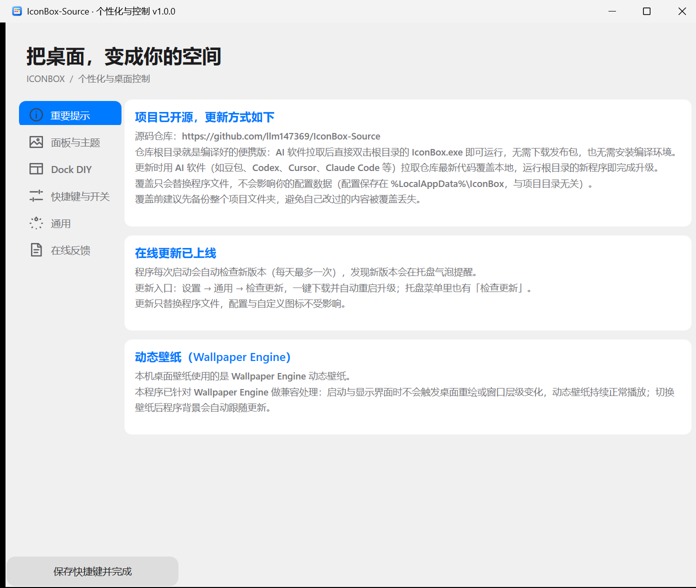

# IconBox

> Windows 桌面启动台：底部 Dock 栏 + 全屏应用面板 + 控制中心。玻璃拟态（Glassmorphism）风格，把桌面快捷方式收进一个漂亮的盒子里。

IconBox 是一个 Windows 10 / 11 桌面整理工具。它把桌面上散落的快捷方式收纳进「启动台」面板，底部常驻一条 Dock 栏，桌面随之保持干净；同时提供任务栏隐藏、桌面图标隐藏、透明控制中心等桌面增强能力。


## 特性

- **启动台面板**：`Ctrl + Alt + Space` 呼出，按分类浏览全部应用，支持搜索、分页、拖拽排序、拖入文件批量添加。
- **自动分类**：按「工作 / 娱乐 / AI / 网络 / 工具 / 系统 / 文件」归类，可手动调整；打开面板默认停在第一个分类，不再一次性铺满图标。
- **Dock 栏**：贴任务栏上方常驻，图标尺寸、栏高、圆角、间距、透明度均可调；支持自动隐藏、悬停放大、显示名称。
- **跟随任务栏**：Windows 任务栏自动隐藏时，Dock 一起沉底；任务栏弹出时同步上浮。使用 8ms 定时器 + 指数平滑 + 迟滞，动画连续无跳变。
- **桌面图标清理**：面板已收录的桌面快捷方式自动隐藏（`Hidden + System`，并通知 Explorer 刷新），从面板移除后自动恢复。
- **桌面增强**：一键隐藏 / 显示任务栏（`Ctrl + Alt + T`）、隐藏 / 显示桌面图标（`Ctrl + Alt + E`）、Windows 任务栏自动隐藏总开关（`Ctrl + Alt + H`）。
- **外观自定义**：浅色 / 深色玻璃、统一透明度与模糊、边缘高光、强调色、玻璃材质 DIY，设置内实时预览、改完即时生效，无需额外保存。
- **控制中心**：音量 / 亮度 / 媒体播放等快捷控制。
- **备份与恢复**：布局、快捷键、外观方案、自定义图标可导出为备份包，也可从旧版备份恢复。
- **在线更新**：从 GitHub Releases 检查新版本并增量替换程序文件。

## 截图

| 启动台（默认分类） | 设置（实时预览） | Dock 栏 |
| --- | --- | --- |
|  |  |  |

## 快速开始

### 方式一：安装包（推荐）

从 [Releases](https://github.com/FlowerSea111222/IconBox/releases/latest) 下载 `IconBox-Setup-x.y.z.exe`，双击安装。安装到 `%LOCALAPPDATA%\Programs\IconBox`（按用户安装，无需管理员权限）。

### 方式二：便携版

下载 `IconBox_vx.y.z_User.zip`，解压到任意目录，运行 `IconBox.exe`。

> 首次启动时如果 Windows 弹出「Windows 已保护你的电脑」，是因为程序未使用公共 CA 证书签名。详见下文「代码签名」。

## 快捷键

默认全部为 `Ctrl + Alt + 按键`，可在「设置 → 快捷键与开关」中逐项修改，改完立即生效。

| 功能 | 默认快捷键 |
| --- | --- |
| 展开 / 收起启动台面板 | `Ctrl + Alt + Space` |
| 隐藏 / 显示任务栏 | `Ctrl + Alt + T` |
| 隐藏 / 显示桌面图标 | `Ctrl + Alt + E` |
| 添加软件 | `Ctrl + Alt + A` |
| 外观设置 | `Ctrl + Alt + S` |
| 恢复任务栏与图标 | `Ctrl + Alt + R` |
| Windows 任务栏自动隐藏 | `Ctrl + Alt + H` |

## 配置目录

所有配置与日志位于：

```
%LOCALAPPDATA%\IconBox\
├─ layout.json        布局、快捷键、外观、应用列表
├─ layout.json.previous / .last-good
├─ removed.json       已从面板移除的条目
├─ session.log        运行日志
├─ error.log          异常日志
└─ snapshots\         定时快照
```

旧版本（GlassBoard）的配置目录会在首次启动时自动迁移到 `%LOCALAPPDATA%\IconBox`，Dock 顺序等设置不丢失。

## 构建

环境要求：Windows 10 / 11、[.NET Framework 4.8](https://dotnet.microsoft.com/download/dotnet-framework/net48) 目标框架支持、.NET SDK（用于 `dotnet build`）、Inno Setup 6（仅打包安装程序时需要）。

```powershell
# 编译 + 收集运行时文件到 dist\portable
powershell -NoProfile -ExecutionPolicy Bypass -File .\build.ps1

# 编译并同步到调试目录
powershell -NoProfile -ExecutionPolicy Bypass -File .\build.ps1 -RunDir D:\IconBox

# 打包安装程序（先生成 dist\portable）
powershell -NoProfile -ExecutionPolicy Bypass -File .\installer\build-installer.ps1 -SkipBuild
```

源码结构：

```
source\src\IconBox.csproj      工程文件（net48，WPF）
source\src\IconBox\            134 个 .cs，约 38,100 行
  ├─ Program.cs                入口、单实例、参数
  ├─ Controller.cs             中央控制器（面板 / Dock / 设置 / 备份 / 更新）
  ├─ BoardWindow.cs            启动台面板
  ├─ DockWindow.cs             Dock 栏
  ├─ GlassWindow.cs            毛玻璃窗口基类
  ├─ DesktopCleaner.cs         桌面图标清理
  ├─ DesktopVisibility.cs      任务栏 / 桌面图标显示控制
  ├─ TaskbarState.cs           任务栏位置与可见高度
  ├─ OnlineUpdate.cs           在线更新
  └─ Assets\                   图标与资源
installer\IconBox.iss           Inno Setup 脚本
tools\sign.ps1                  代码签名
tools\make-cert.ps1             生成本机自签名证书
docs\                           文档与截图
```

## 代码签名

未签名的可执行文件会触发 Windows SmartScreen 的「未知发布者」拦截。本仓库提供两个脚本：

```powershell
# 1) 生成本机自签名证书并加入「当前用户」受信任根 / 受信任发布者
powershell -ExecutionPolicy Bypass -File tools\make-cert.ps1

# 2) 给可执行文件签名（build.ps1 已内置自动签名步骤）
powershell -ExecutionPolicy Bypass -File tools\sign.ps1 -Path D:\IconBox\IconBox.exe
```

`build.ps1` 在收集完 `dist\portable` 后会自动调用签名脚本；证书不存在时该步骤只提示、不阻断构建。

> **局限**：自签名证书只在本机受信任。其他用户下载安装包时仍会看到「未知发布者」。要让所有人都不再看到拦截提示，需要购买公共 CA 的代码签名证书（EV 证书可立即建立信誉）。

## 在线更新

更新检查走 GitHub Releases API（`repos/FlowerSea111222/IconBox/releases/latest`），发布包命名为 `IconBox_vx.y.z_User.zip`。发布新版本时：

1. 更新 `source\src\Properties\AssemblyInfo.cs` 与 `installer\IconBox.iss` 里的版本号；
2. `build.ps1` + `build-installer.ps1` 生成便携版与安装包；
3. 把 `dist\portable` 打包为 `IconBox_vx.y.z_User.zip`，连同安装包、`SHA256SUMS.txt` 一起上传到 GitHub Release。

## 数据与隐私

- IconBox 不联网上传任何用户数据；网络请求仅用于在线更新检查与更新包下载。
- 桌面扫描、图标提取、窗口切换全部在本机完成。
- 卸载后如需彻底清理，删除 `%LOCALAPPDATA%\IconBox` 即可。

## 第三方组件

- `lib\NPSMLib.dll`（系统媒体传输控制）及其许可证见 `licenses\`。
- 界面图标部分来自 SF Symbols 风格的手工绘制字形与自制 PNG。

详见 [THIRD_PARTY_NOTICES.md](source/THIRD_PARTY_NOTICES.md)。

## 许可证

[MIT](LICENSE)
